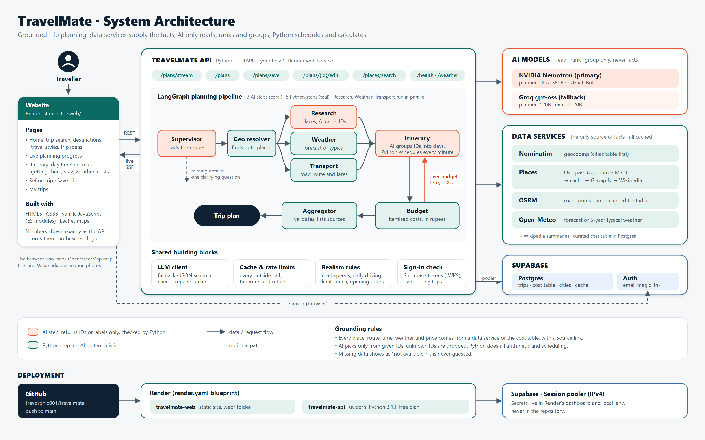

# TravelMate AI

TravelMate AI turns a one-line request ("3 days from Guwahati to Shillong for 2, Rs 8000, waterfalls")
into a cited, budget-checked, map-ready day-wise itinerary, using only free APIs.

**The design is grounded.** Tools produce the facts: OpenStreetMap, OSRM, Open-Meteo, Wikipedia and
the curated cost table. Python does all the arithmetic. The LLM (NVIDIA Nemotron, with Groq and
Gemini as fallbacks) only extracts the request, ranks candidate IDs and groups IDs into days. Any ID
the LLM invents is dropped, and every item shown carries a `source` and a `confidence`
(`verified` / `estimated` / `unavailable`).

- Spec: [docs/PRD.md](docs/PRD.md) · **architecture: [docs/ARCHITECTURE.md](docs/ARCHITECTURE.md)**
- Graph: [docs/graph.md](docs/graph.md) · sources and compliance: [docs/DATA_SOURCES.md](docs/DATA_SOURCES.md) · [docs/LIMITATIONS.md](docs/LIMITATIONS.md)

## Architecture



Details: [docs/ARCHITECTURE.md](docs/ARCHITECTURE.md). Pipeline at a glance:

```
Supervisor (LLM, extract) ─► Geo ─┬─► Research (Overpass + LLM rank by ID) ─┐
                                  ├─► Weather (Open-Meteo)                   ├─► Itinerary (LLM groups IDs; Python schedules)
                                  └─► Transport (OSRM + cost table)          ┘        │
                                                         ┌──── over budget, ≤2× ────┤
                                                         ▼                          ▼
                                                    Itinerary ◄── Budget (Python) ──► Aggregator (validators) ─► TripPlan
```

| Path | What lives there |
|---|---|
| `app/tools/` | One client per free data source, all cached (`app/core/cache.py`) and rate-limited |
| `app/llm/` | `complete_json()`: provider fallback, JSON validation, a repair retry, caching and metrics; prompts |
| `app/agents/` | Graph nodes (supervisor, geo, research, weather, transport, itinerary, budget, aggregator) plus the plan editor |
| `app/graph/build.py` | LangGraph `StateGraph` wiring |
| `app/api/` | FastAPI endpoints under `/api/v1`, Supabase JWT auth, rate limits |
| `app/baseline/agent.py` | Single-agent ReAct baseline for the evaluation |
| `eval/` | 40 cases, metrics, runner and bootstrap report |
| `web/` | Framework-free frontend (ES modules and Leaflet) |

At most 4 LLM calls are made per new plan (Supervisor, Research, Itinerary, plus one more Itinerary
run if the budget loop cuts paid activities), and edits make 1 call.

## Setup (Windows PowerShell; Linux/macOS differences in comments)

```powershell
py -3 -m venv .venv                      # Linux: python3 -m venv .venv
.venv\Scripts\Activate.ps1               # Linux: source .venv/bin/activate
pip install -r requirements.txt
copy .env.example .env                   # Linux: cp .env.example .env
```

Fill in `.env`:

| Variable | Where to get it |
|---|---|
| `NVIDIA_API_KEY` | build.nvidia.com → API keys (`nvapi-…`) |
| `GROQ_API_KEY`, `GEMINI_API_KEY` | console.groq.com, aistudio.google.com (optional fallbacks) |
| `MODEL_*` | Run `python -m scripts.smoke_providers` and copy IDs **from its output** |
| `DATABASE_URL` | Supabase → Project Settings → Database → connection string (session pooler) |
| `SUPABASE_URL`, `SUPABASE_ANON_KEY` | Supabase → Project Settings → API (also put them in `web/js/config.js`) |
| `SUPABASE_JWT_SECRET` | Legacy HS256 projects only; newer projects are verified through JWKS automatically |
| `APP_USER_AGENT` | `TravelMateAI/0.1 (contact: you@example.com)`: required by Nominatim and Wikimedia |
| `ADMIN_KEY` | Any long random string; protects `POST /api/v1/eval/run` |

Create the tables and load the reference data:

```powershell
python -m scripts.migrate                # or paste db/migrations/001_init.sql into the Supabase SQL editor
python -m scripts.seed                   # loads data/cost_table.csv and data/cities.csv
```

## Run

```powershell
uvicorn app.main:app --reload --port 8000         # API docs at http://127.0.0.1:8000/docs
python -m http.server 5500 --directory web        # frontend at http://127.0.0.1:5500
python -m scripts.run_demo                        # live golden run of the PRD demo request
```

`http://127.0.0.1:5500/#/plan/fixture` renders `web/data/golden.json` without calling the API.

## Tests

```powershell
pytest -q                 # offline; recorded fixtures in tests/fixtures, no network
ruff check .
pytest -m live tests/test_live_record.py -s   # re-record fixtures from the real APIs (rarely)
```

## Evaluation

```powershell
python -m eval.run --system both --limit 3 --provider nvidia   # smoke run
python -m eval.run --system both --provider nvidia             # full 40 cases (resumable)
python -m eval.report                                          # eval/report.md + web/data/report.json
```

See [eval/README.md](eval/README.md) for how the cases were chosen and what each metric means.

## Deploy (Render)

`render.yaml` describes two free Render services:

- **travelmate-api**: the FastAPI backend. Render asks for the secret values (copy them from your `.env`;
  use the Supabase *Session pooler* URL for `DATABASE_URL`, because Render has no IPv6).
- **travelmate-web**: the `web/` folder as a static site.

In Render choose **New → Blueprint** and pick this repository. The website calls `http://127.0.0.1:8000`
when opened locally and `https://travelmate-api.onrender.com` otherwise (`web/js/config.js`). Add the
website address to Supabase *Authentication → URL Configuration* so sign-in links work.

The free API sleeps when idle, so the first request after a while can take up to a minute.

## Status

The backend, LangGraph pipeline, evaluation harness and frontend are implemented, with 157 offline
tests and a clean ruff run. The full 40-case benchmark is still to do. The cost table
holds preliminary starter prices that the team must replace with researched, cited figures
(see [docs/DATA_SOURCES.md](docs/DATA_SOURCES.md)).
