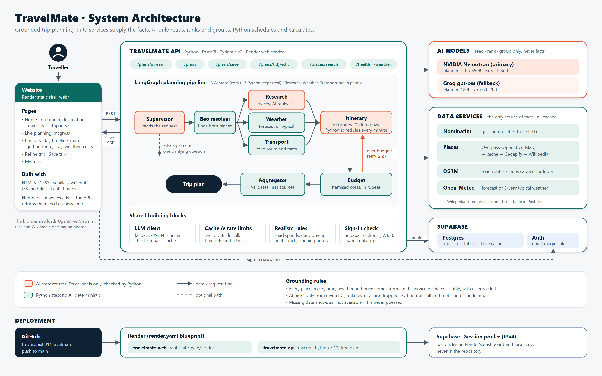
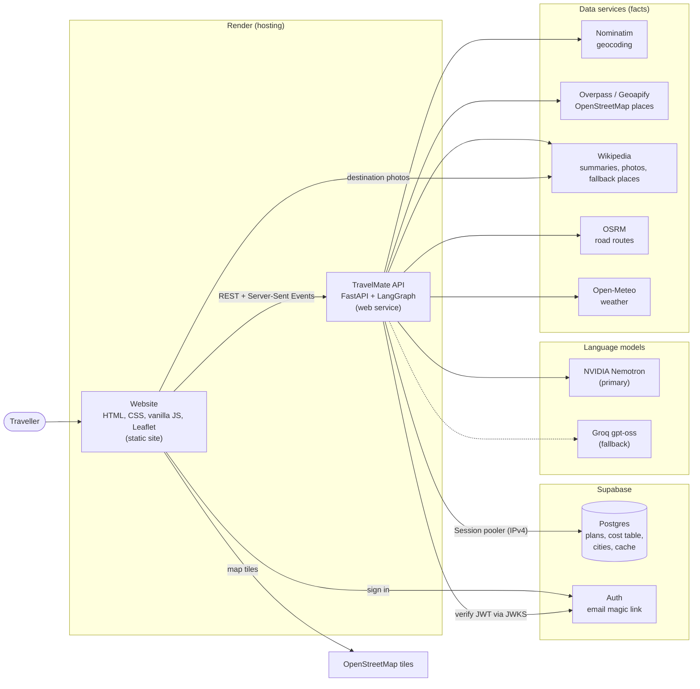
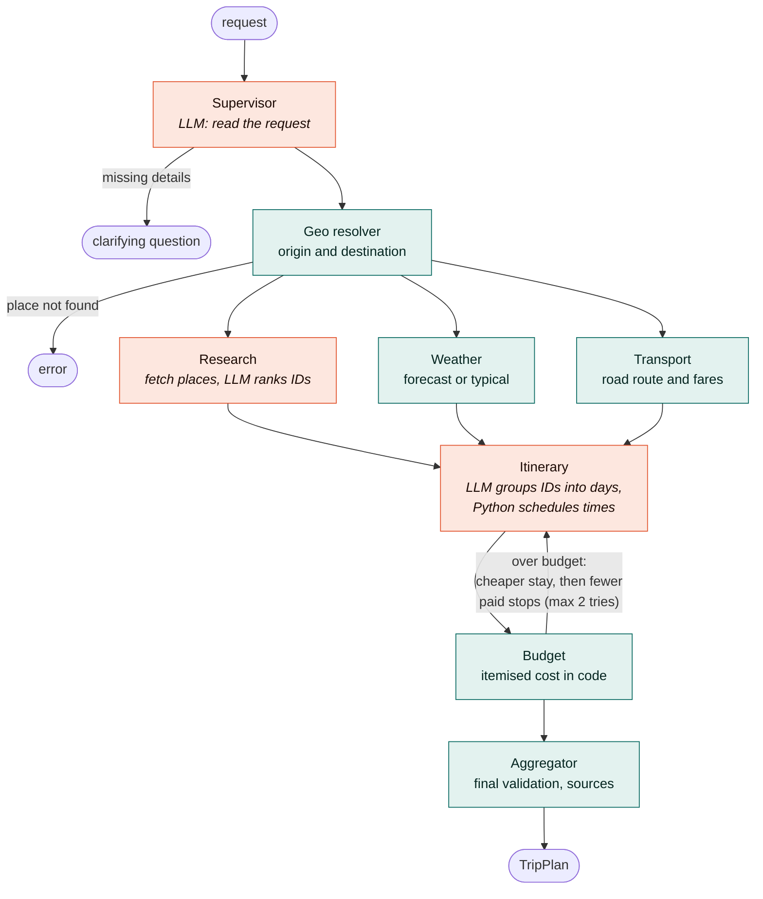
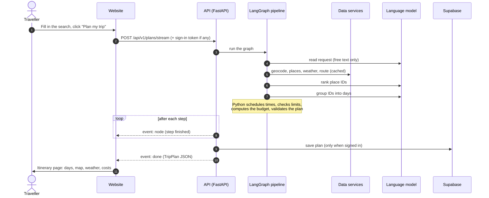
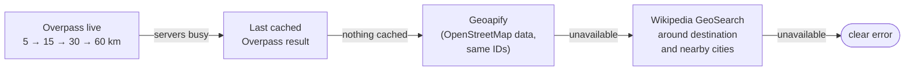
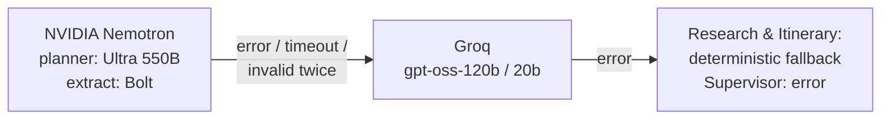
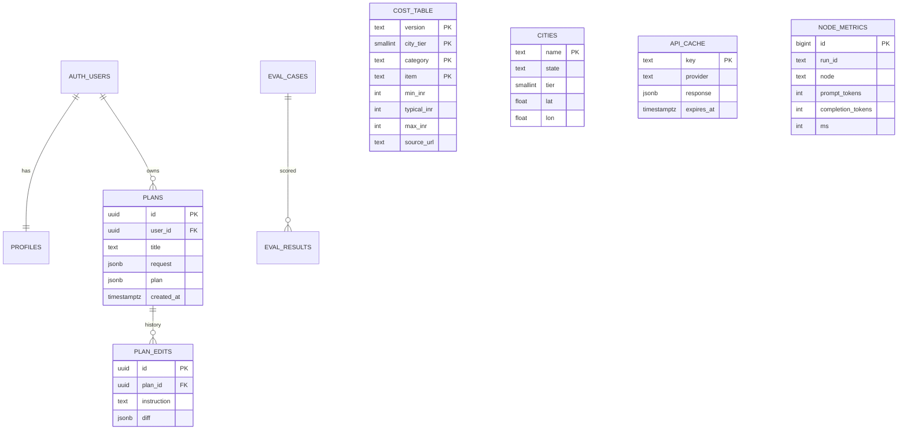
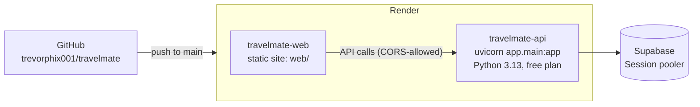

# TravelMate architecture

TravelMate turns a trip request ("3 days from Guwahati to Shillong for 2, Rs 8000, waterfalls") into a
day-by-day itinerary with real places, realistic travel times and an itemised cost estimate.

**Core design rule: tools own the facts.** Places, coordinates, distances, travel times, weather and
prices come only from external data services or the curated cost table. The language models only
*read* the request, *rank* candidate place IDs and *group* IDs into days. Python validates every
model answer, does all arithmetic and schedules every minute of the day.



*Vector version: [architecture.svg](architecture.svg). The sections below explain each part.*

---

## 1. System overview



| Layer | Technology | Where |
|---|---|---|
| Website | HTML5, CSS3, vanilla JavaScript (ES modules), Leaflet | `web/` |
| API | Python, FastAPI, Pydantic v2, sse-starlette | `app/api/`, `app/main.py` |
| Planning pipeline | LangGraph `StateGraph` | `app/graph/`, `app/agents/` |
| Language models | NVIDIA Nemotron (primary), Groq (fallback), OpenAI-compatible client | `app/llm/` |
| Data tools | httpx clients with cache, rate limits and retries | `app/tools/` |
| Database & auth | Supabase Postgres (asyncpg) and Supabase Auth | `app/db/`, `db/migrations/` |
| Hosting | Render static site + Render web service | `render.yaml` |

---

## 2. The planning pipeline (LangGraph)

Eight nodes in a fixed graph. Only three call a language model, and each of those returns IDs or labels
that Python checks; everything else is deterministic code.



| Node | LLM? | What it does | Code |
|---|---|---|---|
| Supervisor | Yes, small model | Turns free text into a `TripRequest`, or asks one clarifying question. Gets a 5-week calendar so dates are copied, not calculated. Form input skips it. | `agents/supervisor.py` |
| Geo resolver | No | Cities table first, then Nominatim. No match is an error, never a guess. | `agents/geo_node.py` |
| Research | Yes, ranking only | Fetches places (see §4), pre-ranks by interest match, notability and distance, then the model picks the best IDs from that list. Unknown IDs are dropped. | `agents/research.py` |
| Weather | No | Forecast within the window, 5-year "typical" weather beyond it. | `agents/weather_node.py` |
| Transport | No | One road route; bus, shared taxi and cab fares from the cost table. | `agents/transport.py` |
| Itinerary | Yes, grouping only | Python clusters places by travel time; the model assigns IDs to days; Python orders stops, adds lunch, checks opening hours, the day window and the daily driving limit, and refills short days. | `agents/itinerary.py` |
| Budget | No | Itemised lines in integer rupees. Over budget → cheaper stay, then fewer paid stops, at most twice; then reports the gap. | `agents/budget.py` |
| Aggregator | No | Checks every stop ID exists, totals equal the sum of lines, dates match; builds the sources list. | `agents/aggregator.py` |

Research, Weather and Transport run **in parallel**; Itinerary waits for all three. A typical new plan uses
**3–4 model calls and about 4,000–5,000 tokens**. Edits to a saved plan use **one** small model call
(`agents/editor.py`), then re-run only the affected days in Python.

---

## 3. One request, end to end



The website draws numbers exactly as the API returns them; it only formats them.

---

## 4. Where facts come from

| Fact | Source | Fallback | Cache |
|---|---|---|---|
| City coordinates | `cities` table (seeded from Nominatim) | Nominatim live (1 request/s) | 30 days |
| Attractions | Overpass (OpenStreetMap) | stale Overpass cache → Geoapify (same OSM data) → Wikipedia GeoSearch | 7 days |
| Place summaries, photos | Wikipedia / Wikimedia Commons | none (optional) | 30 days |
| Road distance & route line | OSRM | straight-line distance × 1.4, labelled approximate | 30 days |
| Travel time | OSRM, capped at 25 km/h (≤ 15 km) and 40 km/h (longer) for Indian roads | 30 km/h straight-line estimate | 30 days |
| Weather | Open-Meteo forecast (16-day window, 1 safety day) | 5-year archive average, labelled "typical" | 3 h / 30 days |
| Prices | `cost_table` in Postgres (min / typical / max, with a source) | line marked "price not available" | — |

All outside calls go through one cache (`app/core/cache.py`, stored in the `api_cache` table), a per-service
rate limiter (`app/core/ratelimit.py`) and timeouts with retries (`app/tools/http.py`).

### Attractions fallback chain



The search widens until there are enough places **matching the traveller's interests** for the trip length
(days × stops per day + 3), so longer trips reach day-trip areas.

### Language model fallback



Every model answer is JSON checked against a Pydantic schema; one repair attempt is made on a validation
error. Validated answers are cached for 7 days. Timeouts: 20 s for reading requests, 45 s for planning.
Code: `app/llm/client.py`, `app/llm/providers.py`, prompts in `app/llm/prompts.py`.

---

## 5. Realism rules (enforced in Python)

| Rule | Value | Code |
|---|---|---|
| Day window | relaxed 10:00–18:00, normal 9:00–20:00, packed 8:00–21:00 | `itinerary.py` `WINDOWS` |
| Stops per day | 3 / 4 / 6 by pace | `STOPS_PER_DAY` |
| Daily road time | relaxed 3 h, normal 4 h, packed 5 h, **including the intercity trip** on arrival and departure days | `MAX_DRIVE_MIN` |
| Over the limit | drop the stop farthest from the stay, then refill with reachable places | `schedule_day`, `refill_days` |
| Lunch | 60 minutes from 12:30 | `LUNCH_FROM` |
| Visit length | per place type, e.g. waterfall 60 min, museum 90 min | `agents/durations.py` |
| Rainy days | outdoor places move to drier days | `move_outdoor_off_rain` |

---

## 6. Data model (Supabase Postgres)



Row Level Security is on for every table; user tables allow owners only. Schema:
`db/migrations/001_init.sql`. Seed data: `data/cities.csv`, `data/cost_table.csv` (`scripts/seed.py`).

---

## 7. API (`/api/v1`)

| Method | Path | Sign-in | Purpose |
|---|---|---|---|
| GET | `/health` | – | Status of models and database |
| POST | `/plans/parse` | – | Free text → trip details or a question |
| POST | `/plans` | optional | Build a plan (saved when signed in) |
| POST | `/plans/stream` | optional | Same, with live progress (Server-Sent Events) |
| POST | `/plans/save` | required | Save a plan made before signing in (re-validated) |
| GET | `/plans` | required | List my trips |
| GET / DELETE | `/plans/{id}` | owner | Open or delete a trip |
| POST | `/plans/{id}/edit` | owner | "Make the stay cheaper", "add a food stop on day 1" |
| GET | `/places/search` | – | City suggestions |
| GET | `/weather` | – | Weather for a place and dates |
| POST / GET | `/eval/run`, `/eval/report` | admin key | Benchmark: single agent vs this pipeline |

Errors are returned as `{type, title, detail}` JSON. Interactive docs: `/docs` on the running API.

---

## 8. Website

| Page | Route | Main file |
|---|---|---|
| Home: search, destinations, travel styles, trip ideas | `#/`, `#/destinations`, `#/ideas` | `web/js/views/home.js` |
| Planning progress | (after search) | `web/js/views/progress.js` |
| Itinerary: days, map, getting there, stay, weather, costs, refine, save | `#/plan/{id}` | `web/js/views/plan.js` |
| My trips | `#/plans` | `web/js/views/myplans.js` |
| How we evaluate plans | `#/eval` | `web/js/views/eval.js` |

Shared modules: `api.js` (one function per endpoint), `sse.js` (stream parsing), `auth.js` (Supabase magic
link), `router.js` (hash routes), `photos.js` (Wikipedia photos), `icons.js`, `config.js` (local vs online
API address).

---

## 9. Code layout

```
app/
  api/        endpoints, sign-in checks, rate and size limits
  agents/     the eight pipeline nodes + plan editor
  graph/      LangGraph wiring and shared state
  llm/        provider fallback, JSON validation, prompts
  tools/      data-service clients and the cost calculator
  db/         connection pool and all SQL
  core/       settings, cache, rate limiter, errors, logging
  schemas/    Pydantic models (TripRequest, TripPlan, ...)
  baseline/   single-agent baseline used in the evaluation
web/          website (HTML, CSS, JS)
data/         cities and cost table (CSV)
db/           SQL migration
eval/         40 test cases, metrics, runner, report
scripts/      seeding, demo run, price research helpers
tests/        offline tests with recorded API responses
```

---

## 10. Security and reliability

- **Secrets** live only in `.env` locally and in Render's dashboard; never in the repository.
- **Sign-in**: Supabase access tokens are verified against the project's public keys (JWKS); trips are
  read, edited and deleted only by their owner, checked in SQL as well as by Row Level Security.
- **Limits**: plan requests are rate-limited per IP (5 per minute, 50 per day); request bodies are capped
  at 4 KB (512 KB for saving a whole trip); free text is capped at 300 characters.
- **Saved trips from the browser** are re-validated on the server before storing, and their sources are
  rebuilt server-side.
- **Failures degrade, not crash**: every outside service has a cache and a fallback, and a failed node
  is reported as a clear error instead of a broken plan.

---

## 11. Deployment



Both services are defined in `render.yaml`. The free API sleeps when idle, so the first request after a
while can take up to a minute.
